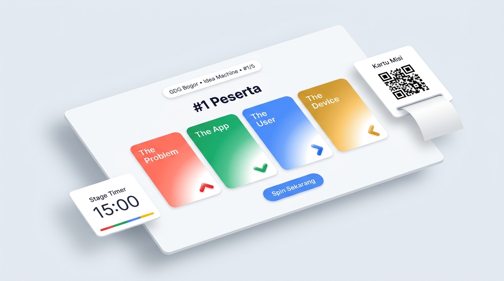

<div align="center">

# Idea Machine — GDG Bogor

**Interactive 4-column stage challenge generator powered by Gemini AI for non-coding Vibe Coding workshops.**

[](https://react.dev/)
[](https://www.typescriptlang.org/)
[](https://vite.dev/)
[](https://ai.google.dev/)

<br />



</div>

---

## Overview

**Idea Machine — GDG Bogor** is a stage-ready web application built for live community workshops where participants build real applications through Vibe Coding—without needing prior programming experience.

Instead of static prompts or engineering jargon, the operator enters a participant's name and triggers a 4-column slot spin (**The Problem**, **The App**, **The User**, **The Device**). Gemini generates a cohesive, grounded Indonesian everyday app challenge in real time, presents it step-by-step on the projector, hands it over via compressed QR code and PDF, and runs a live Stage Timer for the build session.

---

## Key Features

| Feature | Description |
| :--- | :--- |
| **4-Card Gradient Slot Stage** | Borderless color-coded cards (`The Problem`, `The App`, `The User`, `The Device`) with 3D glassmorphism hover, directional vertical motion blur during spin, and sequential column locking. |
| **Progressive Stage Reveal** | Guided stage presentation (`The Problem` → `The App` → `The User` → `Kartu Misi`) written in plain, jargon-free Indonesian tailored for projector readability. |
| **QR Handover & 3D Thermal Brief** | Generates a compact, URL-compressed mission token (`?b=...` powered by `fflate`) scannable on mobile, complete with an interactive 3D rolling thermal receipt view. |
| **5-Participant Queue & PDF Export** | Locks up to 5 stage participants with persistent `localStorage` state, per-participant PDF export, and a combined 5-participant recap PDF (`jspdf`). |
| **Stage Countdown Timer** | Built-in stage timer with Google-spectrum progress feedback, audio wave visualization, Web Audio SFX toggle, and dramatic final-10-second cues. |
| **Event-Day Gemini Resilience** | Server-side failover across `gemini-4-hydrogen` and `gemini-3.1-flash-lite`, strict per-attempt timeouts, automatic JSON validation retries, client retries, and background mission pre-fetching. |

---

## Stage Workflow

1. **Cover Screen** — Projector-friendly title stage with direct entry to the Idea Machine.
2. **Participant Entry** — Enter the active participant's name (`Peserta #1`–`#5`). While typing, the client quietly warms a real Gemini mission in the background.
3. **Spin Sekarang** — All four reels spin with smooth vertical motion blur and Web Audio ticks, then lock sequentially from left to right before transitioning into the reveal.
4. **Stage Reveal & Kartu Misi** — Walk the audience through **The Problem**, **The App**, and **The User**, then review the consolidated **Kartu Misi** with **Spin Ulang** or **Kunci & Handover QR**.
5. **QR Handover & Stage Timer** — Participants scan their personal mission brief URL or download a PDF, and once ready, the operator launches the live **Stage Timer**.

---

## Architecture & Tech Stack

- **Frontend:** React 19, TypeScript, Vite 8, Tailwind CSS v4, Motion (`motion/react`), Lucide Icons
- **Backend:** Express (`server.ts`) serving both API endpoints and Vite middleware in development
- **AI Engine:** `@google/genai` with structured JSON schema output (`Type.OBJECT`) and multi-model failover
- **Utilities:** `qrcode` (SVG QR generation), `fflate` (deflate compression for QR URLs), `jspdf` (PDF mission cards), Web Audio API synth (`src/utils/audio.ts`)

### Project Structure

```text
.
├── docs/
│   └── images/
│       └── idea-machine-isometric.jpg   # Clean isometric UI showcase graphic
├── src/
│   ├── components/
│   │   ├── BrandMark.tsx                # GDG Bogor mark & 4-color spectrum bar
│   │   ├── CoverView.tsx                # Stage cover view
│   │   ├── FinalizedRecapModal.tsx      # 5-participant summary & PDF export modal
│   │   ├── MissionBriefView.tsx         # Mobile QR brief & 3D rolling thermal receipt
│   │   ├── MissionResultShowcase.tsx    # Progressive stage reveal & Kartu Misi
│   │   ├── ParticipantBoard.tsx         # Participant queue overview
│   │   ├── QrCodeSvg.tsx                # Crisp SVG QR renderer
│   │   ├── QrHandoverModal.tsx          # Stage handover QR modal
│   │   ├── ReelIcon.tsx                 # Domain icon mapper
│   │   ├── SlotReelCard.tsx             # 3D glassmorphism gradient slot card
│   │   └── StageTimerView.tsx           # Live stage countdown & audio visualizer
│   ├── data/
│   │   └── pools.ts                     # Device targets, fallback pools & mission types
│   ├── hooks/
│   │   └── useProjectorDisplay.ts       # Wide projector layout detection
│   ├── utils/
│   │   ├── audio.ts                     # Web Audio API SFX synthesizer
│   │   ├── briefCodec.ts                # Deflate + base64url QR brief codec
│   │   └── pdfExport.ts                 # Single & recap PDF generator
│   ├── App.tsx                          # Stage state machine, prefetch & resilient spin flow
│   ├── index.css                        # Tailwind v4 setup & slot motion keyframes
│   └── main.tsx                         # React entry point
├── server.ts                            # Express server + Gemini API failover endpoint
├── metadata.json                        # App metadata & capabilities
├── package.json                         # Scripts & dependencies
└── .env.example                         # Environment variable template
```

---

## Getting Started

### Prerequisites

- **Node.js** `>= 20`
- A valid **Gemini API Key**

### 1. Install Dependencies

```bash
npm install
```

### 2. Configure Environment Variables

Copy `.env.example` to `.env` and add your Gemini API key:

```bash
cp .env.example .env
```

```env
GEMINI_API_KEY="your_gemini_api_key_here"
```

### 3. Run in Development

Starts the Express server with Vite HMR middleware on port `3000`:

```bash
npm run dev
```

Open `http://localhost:3000`.

### 4. Build & Run for Production

```bash
npm run build
npm start
```

### 5. Typecheck / Lint

```bash
npm run lint
```

---

## API Reference

| Method | Endpoint | Purpose |
| :--- | :--- | :--- |
| `GET` | `/api/health` | Health check endpoint returning `{ "ok": true }`. |
| `POST` | `/api/generate-mission` | Generates a structured Indonesian everyday mission (`problem`, `targetUser`, `solution`, `deviceId`) using Gemini structured outputs with multi-model failover (`gemini-4-hydrogen` / `gemini-3.1-flash-lite`). |

---

## Presentation Shortcuts

| Key | Action |
| :--- | :--- |
| `Space` | Trigger **Spin Sekarang** / **Spin Ulang** on the machine stage |
| `F` | Toggle fullscreen projector mode |
| `←` / `→` | Step backward or forward across reveal stages |
| `Esc` | Close active QR, Recap, or Brief Preview modal |
